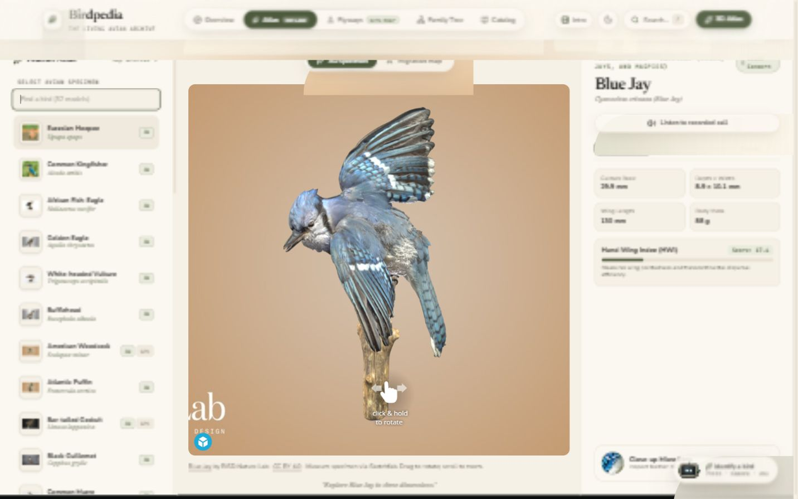
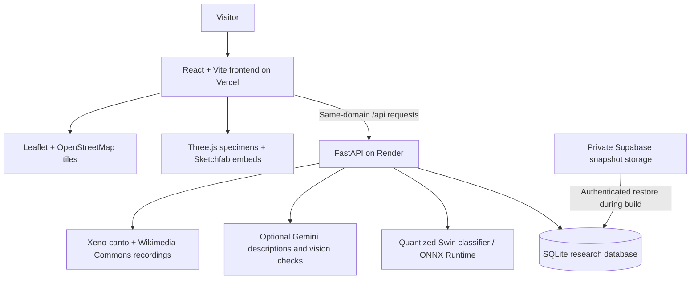

<div align="center">

# 🪶 Birdpedia

### *The living avian archive.*

**Explore birds through interactive 3D specimens, real migration tracks, recorded calls, and photo identification** — bringing an encyclopedia, a field guide, and a digital museum into one place.


**[🌐 Open Birdpedia](https://birdy-theta-jet.vercel.app)** · **[Deployment](DEPLOYMENT.md)** · **[Verification](VERIFICATION.md)**

</div>

---

> *What bird is this? Where does it travel? What does it sound like?*
>
> Upload a bird photo, inspect a specimen in three dimensions, follow archived GPS tracks across continents, or listen to a credited field recording. Birdpedia connects these views through the same species profiles and research data.

The live site uses **one public link**. The free backend wakes automatically after inactivity, so the first data request can take a little time.



## ✨ Highlights

| | Feature | What you can do |
| --- | --- | --- |
| 🪶 | **32-species 3D Atlas** | Rotate and zoom the two original GLB specimens and explore 30 museum models through Sketchfab. The original models appear first, followed by museum specimens grouped by taxonomic order and name. |
| 📚 | **Species encyclopedia** | Search 10,824 species in the deployed catalogue, filter by taxonomy and conservation status, and inspect morphology, ecology, photos, and source data. |
| 📷 | **Bird identification agent** | Upload a photo or use the camera upload control. A quantized Swin classifier ranks 526 labels on the CPU; optional Gemini assistance adds descriptions and checks uncertain identifications. |
| 🗺️ | **Migration flyways** | Explore 742,755 archived GPS fixes, select tracked species, and play tracks along a timeline on an interactive Leaflet map. |
| 🔊 | **Real recorded calls** | Play species-specific recordings from Xeno-canto with a Wikimedia Commons fallback, including recordist, source, and licence credits. |
| 🌳 | **Family tree** | Explore bird relationships through interactive family and species phylogeny views. |
| 🌗 | **Day and dusk** | Switch lighting themes, use the responsive navigation, and open a focused specimen view. |

## 🧠 How it works



1. The frontend requests species, telemetry, images, and identification results through `/api`.
2. Vercel forwards those requests to the Python backend without changing the website's public URL.
3. FastAPI reads the research database and runs photo classification using the checked-in ONNX model.
4. Optional provider integrations supply generated answers, vision checks, and recorded audio.
5. During a hosted build, Render restores a verified SQLite snapshot from private Supabase Storage. The application continues to query SQLite; Supabase stores the deployment snapshot.

## 📁 Project structure

```text
Birdy/
├── frountend/                    # React + TypeScript application (folder spelling preserved)
│   ├── src/
│   │   ├── components/           # 3D Atlas, bird cards, agent, map, and tree
│   │   ├── pages/                # Overview, catalogue, flyways, and phylogeny
│   │   ├── data/                 # Model catalogue and presentation data
│   │   └── lib/                  # Typed API client, audio, and shared helpers
│   └── vercel.json               # /api forwarding and SPA routing
├── backend/
│   ├── app/
│   │   ├── routers/              # HTTP API endpoints
│   │   ├── services/             # Classifier, agent, recordings, and track processing
│   │   └── ingest/               # Offline research-data import pipeline
│   ├── tests/                    # API smoke checks and regression tests
│   ├── start.py                  # Hosted startup and snapshot restoration
│   ├── prepare_snapshot.py       # Consistent, compressed database snapshot creation
│   └── requirements-runtime.txt  # Serving dependencies without bulk-ingest libraries
├── models/                       # Quantized ONNX classifier and label mapping
├── supabase/functions/           # Authenticated deployment-snapshot function
├── design/verification/          # Interface screenshots
├── render.yaml                   # Free Python service configuration
├── DEPLOYMENT.md                 # Live infrastructure and deployment instructions
└── VERIFICATION.md               # Checks, evidence, and known limits
```

## 🚀 Quick start

### Prerequisites

- Python **3.11+** and Node.js **20+** with npm.
- The populated database at **`backend/birds.db`**. It is intentionally excluded from Git; cloning the repository alone does not provide the research data. Obtain an authorized snapshot or rebuild it from the original datasets.
- The classifier and labels under `models/`, included in the repository.

### 1 · Clone and start the API

```powershell
git clone https://github.com/lukan-lawslaf/Birdy.git
cd Birdy/backend

python -m venv .venv
.\.venv\Scripts\Activate.ps1
pip install -r requirements-runtime.txt

# Place the populated birds.db in this directory before starting.
python -m uvicorn app.main:app --reload --port 8000
```

On macOS/Linux, activate the environment with `source .venv/bin/activate`.

API documentation is available at **http://localhost:8000/docs**.

### 2 · Start the frontend

In another terminal:

```powershell
cd Birdy/frountend
npm ci
npm run dev
```

Open **http://localhost:5173**. Vite forwards `/api` to `http://127.0.0.1:8000`; `BIRDPEDIA_API_TARGET` can override that development target.

### 3 · Optional provider configuration

Create a `.env` file in the repository root:

```dotenv
GOOGLE_KEY=your_google_api_key
XENO_CANTO_KEY=your_xeno_canto_key
```

| Setting | Purpose |
| --- | --- |
| `GOOGLE_KEY` | Generated species answers and optional vision verification. Without it, local classification and template summaries remain available. |
| `XENO_CANTO_KEY` | Xeno-canto archive access. Wikimedia Commons provides an independent fallback where recordings exist. |
| `VITE_API_URL` | Frontend API base, defaulting to `/api`. The deployed site uses the same-domain Vercel rewrite. |
| `BIRDPEDIA_API_TARGET` | Development-only destination for Vite's `/api` proxy. |

Map tiles and public Sketchfab embeds need no API key. Keep provider keys on the backend; never place them in `VITE_` variables.

For rebuilding the database, install `backend/requirements.txt`, configure the source paths in `backend/app/config.py`, and use the loaders under `backend/app/ingest/`. The ingest entry point is `python -m app.ingest.run`; its loaders rebuild their source tables, so use it deliberately with the required datasets available. eBird and Movebank imports have separate credentials.

## 🔌 Useful endpoints

The deployed routes below use **`https://birdy-theta-jet.vercel.app/api`** as their base. Local FastAPI routes do not include the `/api` prefix.

| Endpoint | Purpose |
| --- | --- |
| `GET /health` | Database and classifier readiness |
| `GET /species` | Paginated catalogue and filters |
| `GET /species/search?q=kingfisher` | Species search |
| `GET /species/{name}` | Species profile |
| `GET /species/{name}/audio/commons` | Credited fallback recordings |
| `GET /tracking/species` | Available tracked species |
| `GET /tracking/species/{name}/tracks` | Migration tracks as GeoJSON |
| `GET /phylogeny/tree` | Family tree data |
| `POST /agent/identify` | Photo identification with a species summary |
| `POST /agent/ask` | Answer a question using a species factsheet |
| `GET /coverage` | Dataset coverage and provenance |

## ☁️ Deployment

| Component | Host | Plan |
| --- | --- | --- |
| React frontend and `/api` routing | Vercel | Hobby |
| Python API, SQLite, and ONNX inference | Render | Free |
| Private database snapshot | Supabase | Free |

**Visitors only need [the website link](https://birdy-theta-jet.vercel.app).** Render wakes on incoming API requests, and the frontend retries temporary gateway failures while it starts.

The current Vercel release was deployed using the CLI. Automatic Vercel deployments from GitHub are not connected yet. See [DEPLOYMENT.md](DEPLOYMENT.md) for the live configuration, snapshot workflow, and update commands.

## 🧪 Validation

```powershell
# Frontend production build
cd frountend
npm run build

# Backend regression tests (from backend/, with its environment activated)
python -m unittest discover -s tests -p "test_*.py"
```

The deployment passed **58 API smoke checks** through the public website and **10 backend regression tests**. The private snapshot restore and its access controls were also verified. These are deployment-time results, not a continuous uptime guarantee. See [VERIFICATION.md](VERIFICATION.md) and the deployment notes for scope and limitations.

## 📚 Data and credits

Birdpedia combines research datasets and third-party media. Source licences remain separate from the application code.

- **AVONET** — morphology, ecology, range, and spatial data.
- **BirdLife International / IUCN categories** — conservation information and phylogeny sources.
- **eBird and GBIF** — taxonomy, observations, hotspots, and occurrence summaries.
- **Movebank and Sagebrush studies** — archived animal-borne telemetry, with study-specific attribution.
- **Xeno-canto and Wikimedia Commons** — field recordings with recording-specific credits and licences.
- **Sketchfab museum collections** — 30 credited specimen models; source and licence links appear in the viewer.
- **OpenStreetMap** — attributed base-map tiles.
- **Bird image datasets and Wikipedia** — identification training labels and species imagery; media rights vary by source.

Tracks are archived research observations, not live positions. Identification covers the classifier's label set, and recording availability varies by species. Consult `/api/coverage` and the in-app credits for provenance before reusing source data or media.

## 📜 Documentation

- [Deployment](DEPLOYMENT.md) — hosting, snapshot restoration, and release instructions.
- [Verification](VERIFICATION.md) — implementation checks and practical limits.
- [Project history](progress.md) — development notes and prior decisions.

---

<div align="center">

**Built with React · Three.js · FastAPI · ONNX Runtime · SQLite** 🪶

*One archive. A world of birds.*

</div>
